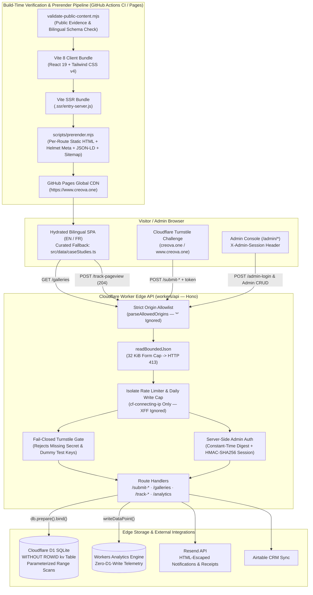

# CREOVA (`creova.one`)

**Bilingual (`EN` / `FR`) prerendered web platform and hardened Cloudflare Workers + D1 edge API powering Ontario's BIPOC creative agency & venture studio flagship.**

[](https://github.com/creova-gif/creova/actions/workflows/ci.yml)

Live production site: **[https://www.creova.one](https://www.creova.one)** · License: **[Proprietary — All Rights Reserved](LICENSE)**

---

## Current Implementation Status

| Capability / Subsystem | Location | Status | Verification Evidence |
| --- | --- | --- | --- |
| **Bilingual (`EN` / `FR`) React 19 + Vite 8 Frontend** | `src/` | **Implemented & Verified** | `npm run lint` (`--max-warnings=0`), `npm run typecheck` |
| **Build-Time SSR Route Prerendering & Sitemap Pipeline** | `src/entry-server.tsx`, `scripts/prerender.mjs` | **Implemented & Verified** | `npm run build` renders all public `EN` & `/fr` routes + `sitemap.xml` + legacy `301`/redirect pages |
| **Public Content & Evidence Contract Validator** | `scripts/validate-public-content.mjs`, `src/content/public-evidence.json` | **Implemented & Verified** | Runs pre-build in CI; blocks unpublished or malformed client case studies |
| **Cloudflare Worker + D1 + Analytics Engine API (Hono)** | `workers/api/src/` | **Implemented & Verified** | 50 Worker unit & Miniflare/Vitest runtime tests (`workers/api/`) |
| **Fail-Closed Turnstile Gate, Bounded JSON & HMAC Admin Auth** | `workers/api/src/guards.ts`, `workers/api/src/index.ts` | **Implemented & Verified** | Tested across 4 isolated Wrangler Worker configurations (`routes`, `local-skip`, `dummy-secret`, `admin-unconfigured`) |
| **Resend HTML-Escaped Transactional Mail & Airtable Sync** | `workers/api/src/email-templates.ts`, `workers/api/src/index.ts` | **Implemented & Verified** | Header-break stripping (`oneLine`), HTML entity escaping (`escapeHtml`), best-effort D1 `200`/`202` degradation |
| **Legacy Storefront / Checkout Routes (`COMMERCE_ROUTES`)** | `workers/api/src/guards.ts` | **Retired (`410 Gone` Enforced)** | Deterministically returns `HTTP 410` across all 13 legacy payment/shop endpoints |
| **Legacy Supabase Edge Function** | `src/supabase/functions/server/` | **Deprecated (Parity Only)** | Retained strictly for 22 security guard parity tests (`guards.test.ts`); not deployed |
| **Cross-Venture Fintech Architecture Thesis** | `docs/archive/EAST-AFRICA-FINTECH-THESIS.md` | **Conceptual / Thesis Only** | Archived research document; explicitly separated from production agency code |

---

## Problem Statement & Operational Context

Creative agency and venture studio flagships face a recurring operational tension:
1. **Crawler & Unfurl Fidelity vs. SPA Interactivity:** Pure client-rendered React SPAs ship an empty `<div id="root"></div>` with a single generic `<title>`, degrading search indexing, bilingual `hreflang` discovery (`/` vs. `/fr/*`), and social OpenGraph previews.
2. **Zero-Downtime Availability Under Free-Tier Constraints:** Backing public marketing pages or telemetry with a traditional database risks cold-start stalls, project pausing, or exhausting daily row-write quotas during traffic spikes.
3. **Abuse-Resistant Public Intake:** Contact, booking, studio rental, and collaboration endpoints exposed to the public internet require strict payload bounds, non-spoofable IP rate limiting, bot verification that fails closed when misconfigured, and XSS/header-injection-safe transactional email templates.

---

## System Architecture



---

## Engineering Decisions & Trade-Offs

Full architectural rationale is recorded in **[ADR 0001: Prerendered Bilingual React SPA + Cloudflare Worker & D1 Edge API](docs/adr/0001-cloudflare-worker-d1-edge-api-and-prerendered-spa.md)**.

### 1. Build-Time React 19 SSR Prerendering with Deterministic Offline Fallback
- **Decision:** Compile a dedicated SSR bundle (`vite build --ssr src/entry-server.tsx --outDir .ssr`) and execute `scripts/prerender.mjs` during `npm run build` to emit static `index.html` files for every English (`/`, `/work/<slug>`, `/journal/<slug>`, service-area pages) and French (`/fr/...`) route, stripping duplicate fallback `<head>` tags and normalizing `hreflang` attributes.
- **Why / Trade-off:** Eliminates runtime SSR compute costs and guarantees `www.creova.one` stays 100% online via static CDN even if the edge API is unreachable. When `VITE_API_BASE_URL` is unset at build time, `loadGalleries()` deterministically falls back to curated repository case studies (`src/data/caseStudies.ts` gated by `src/content/public-evidence.json`).

### 2. `WITHOUT ROWID` Cloudflare D1 Schema & Binary UTF-8 Prefix Scans
- **Decision:** Store leads and admin-managed galleries in a single `WITHOUT ROWID` primary-key D1 table (`workers/api/migrations/0001_create_kv.sql`) without secondary indexes, querying key namespaces via exclusive UTF-8 code-point upper bounds (`WHERE key >= ?1 AND key < ?2` in `workers/api/src/kv.ts`) rather than `LIKE 'prefix%'` or full-table scans.
- **Why / Trade-off:** On Cloudflare D1, every secondary index update counts as an additional billable row write, and hitting the daily write cap halts D1 queries until `00:00 UTC`. `WITHOUT ROWID` guarantees `1` insert = `1` row write, while parameterized binary range bounds preserve index-ordered prefix reads (`gallery_` -> `['gallery_', 'gallery`')`). Furthermore, if D1 experiences quota exhaustion, `persistLead()` degrades gracefully (`HTTP 202`) so Resend emails and Airtable CRM sync still succeed.

### 3. Zero-D1-Write Telemetry via Workers Analytics Engine
- **Decision:** Route `/track-pageview` and `/track-event` exclusively to Cloudflare Workers Analytics Engine (`writeDataPoint`), dropping noisy `page_exit` beacons (`204 No Content`) and enforcing per-IP rate limits (`20 req/min` and `200 points/UTC day/IP`).
- **Why / Trade-off:** Keeps page-view D1 writes at **zero**, sustaining ~33,000–50,000 daily views comfortably inside Cloudflare Workers Free Tier (`100k req/day`, `100k Analytics Engine points/day`).

### 4. Fail-Closed Bot Verification, Spoof-Proof IP Keys & Bounded JSON Parsing
- **Decision:**
  - **Bounded Payload Reader (`readBoundedJson`):** Checks both `Content-Length` and actual UTF-8 byte length before `JSON.parse`, rejecting oversized form payloads (`> 32 KiB`, or `> 4 KiB` on telemetry) with `HTTP 413`.
  - **Fail-Closed Turnstile Gate (`turnstileGate`):** Rejects Cloudflare's published always-pass dummy secret (`1x0000000000000000000000000000000AA`) as unconfigured (`HTTP 503`), verifies hostname (`creova.one` / `www.creova.one`) on `siteverify` responses, and permits loopback bypass **only** when `CREOVA_ENV` matches exact local values (`development`, `dev`, `local`, `test`) **and** the request host is loopback (`localhost` / `127.0.0.1` / `::1`).
  - **Non-Spoofable Rate-Limit Key (`rateLimitClientIp`):** Uses Cloudflare's platform-injected `cf-connecting-ip` header exclusively—never trusting client-spoofable `X-Forwarded-For` prefixes. Per-isolate in-memory maps were chosen intentionally over Workers KV (`1,000 free writes/day`) to avoid exhausting write quotas under flood traffic.
  - **Strict CORS & Admin Sessions:** `parseAllowedOrigins` defaults to `https://www.creova.one` and `https://creova.one` and explicitly ignores a bare `"*"` wildcard. Admin passwords are verified server-side via SHA-256 `crypto.subtle.digest` constant-length bitwise comparison (`passwordsMatch`), issuing HMAC-SHA256 session tokens (`ADMIN_SESSION_SECRET`).

---

## Technology Stack

| Layer | Technologies |
| --- | --- |
| **Frontend & SSR Prerender** | TypeScript 6, React 19, Vite 8, React Router 8, Tailwind CSS v4, Radix UI, Motion, `@dr.pogodin/react-helmet` |
| **Edge API Runtime** | Cloudflare Workers, Hono 4, Cloudflare D1 (SQLite), Workers Analytics Engine, Wrangler 4 |
| **Security & Integrations** | Cloudflare Turnstile, Web Crypto (`HMAC-SHA256` / `SHA-256`), Resend API, Airtable REST API |
| **Quality & Testing** | ESLint 10 (`--max-warnings=0`), TypeScript (`tsc --noEmit`), Node `node:test`, `@cloudflare/vitest-plugin` + Miniflare (Vitest 4) |

---

## Prerequisites & Quickstart

### Prerequisites
- **Node.js 22+** and `npm`

### Clean-Clone Install & Local Development

```bash
git clone --depth 5 https://github.com/creova-gif/creova.git
cd creova

# Install frontend and Worker dependencies deterministically from lockfiles
npm ci
npm --prefix workers/api ci

# Start local Vite development server (http://localhost:5173)
npm run dev
```

To run the Cloudflare Worker + local D1 SQLite database locally without touching remote Cloudflare resources:

```bash
cd workers/api
npx wrangler d1 migrations apply creova --local
npx wrangler dev --local
```

---

## Configuration & Environment Variables

Copy `.env.example` to `.env.local` for local frontend overrides. **Never place secret keys in `VITE_*` variables**—anything prefixed `VITE_` is inlined into the public client bundle. Worker secrets are provisioned via `wrangler secret put` (or `.dev.vars` locally, which is gitignored).

| Variable | Scope | Default / Fail-Closed Behavior |
| --- | --- | --- |
| `VITE_API_BASE_URL` | Frontend (`VITE_`) | Optional. When unset, telemetry stays quiet and public routes prerender from curated local data. |
| `VITE_TURNSTILE_SITE_KEY` | Frontend (`VITE_`) | Public Cloudflare Turnstile widget site key. |
| `VITE_SENTRY_DSN` | Frontend (`VITE_`) | Optional browser error reporting DSN. |
| `VITE_SEEN_SITE_URL` / `VITE_VERSE_SITE_URL` | Frontend (`VITE_`) | Optional outbound CREOVA venture URLs. |
| `TURNSTILE_SECRET_KEY` | Worker Secret | **Fails closed (`503`)** on all `/submit-*` mutations when unset or set to Cloudflare's dummy test key. |
| `ADMIN_PASSWORD` | Worker Secret | **Fails closed (`500`)** on `/admin-login` when unset; compared in constant time on the Worker. |
| `ADMIN_SESSION_SECRET` | Worker Secret | **Fails closed (`500`/`401`)** when unset; signs and verifies `X-Admin-Session` HMAC tokens. |
| `ALLOWED_ORIGINS` | Worker Var/Secret | Defaults to `https://www.creova.one,https://creova.one`; bare `*` is ignored. |
| `EMAIL_SERVICE_API_KEY` / `AIRTABLE_API_KEY` | Worker Secret | Resend transactional email key and Airtable CRM key. |
| `CLOUDFLARE_ACCOUNT_ID` / `ANALYTICS_API_TOKEN` | Worker Secret | Optional read-only Analytics Engine SQL API credentials for `/analytics`. |

---

## Local Verification & Automated Test Suite

All four verification gates defined in [`.ai/project.yaml`](.ai/project.yaml) run on every push and pull request in [`.github/workflows/ci.yml`](.github/workflows/ci.yml):

```bash
npm run lint        # ESLint 10 flat config across repo (--max-warnings=0)
npm run typecheck   # Root tsc --noEmit + workers/api wrangler types & tsc --noEmit
npm test            # 72 automated tests (Node guard/analytics suites + 4 Miniflare Worker Vitest suites)
npm run build       # validate-public-content -> client build -> SSR build -> static route prerender
```

### Automated Test Breakdown (`72` Passing Tests)
- **Worker Pure Security, Prefix-Range & Telemetry Unit Tests (`27` tests — `workers/api/src/guards.test.ts` & `analytics.test.ts`):** Verifies UTF-8 binary `prefixBounds`, daily per-IP tracking write budgets, HTML/header injection escaping (`escapeHtml`, `oneLine`), catalog price integrity, Turnstile hostname/action/dummy-secret rejection, wildcard CORS refusal, `cf-connecting-ip` extraction, and constant-time password hashing.
- **Worker Runtime & D1 Integration Tests (`23` tests — `workers/api/test/*.test.ts` via `@cloudflare/vitest-plugin`):**
  - `vitest.config.ts` (`17` tests): Production-posture route tests against local D1 (`503` fail-closed forms without Turnstile, `410` retired commerce routes, CORS reflection/rejection, primary-key range gallery reads, `413` oversized body rejection, rate limiting, HMAC admin login/CRUD round-trips).
  - `vitest.local.config.ts` (`4` tests): Loopback `CREOVA_ENV=test` Turnstile skip, non-loopback rejection even when `CREOVA_ENV=test`, Airtable sync, and `202` graceful degradation when D1 throws.
  - `vitest.dummy.config.ts` (`1` test): Confirms Cloudflare's published dummy secret still fails closed (`503`) in production mode.
  - `vitest.admin-unconfigured.config.ts` (`1` test): Confirms `/admin-login` returns `500` for both valid and invalid passwords when `ADMIN_SESSION_SECRET` is missing.
- **Legacy Guard Parity Suite (`22` tests — `src/supabase/functions/server/guards.test.ts`):** Ensures shared guard invariants remain unbroken until the deprecated `src/supabase/` directory is retired.

---

## Security & Privacy Posture

- **Vulnerability Disclosure:** Private reporting instructions and scope are documented in [`SECURITY.md`](SECURITY.md).
- **Zero Hardcoded Secrets:** `.env*`, `.dev.vars`, `.secrets.json`, `*.pem`, `*.key`, and `utils/supabase/info.tsx` are gitignored; all Worker secrets live in Cloudflare's encrypted secret store.
- **Least-Privilege Workflows:** `.github/workflows/deploy-worker.yml` is strictly manual (`workflow_dispatch` requiring explicit `confirm == "deploy"` input), declares `permissions: contents: read`, and refuses to deploy if `wrangler.toml` still holds the placeholder D1 `database_id`.

---

## Deployment, Operations & Known Limitations

- **Frontend Hosting:** Static `build/` output (prerendered HTML + `sitemap.xml` + `CNAME` + legacy redirect pages) deploys via [`.github/workflows/deploy.yml`](.github/workflows/deploy.yml) to `https://www.creova.one`.
- **Edge Worker Operations & Rollback:** Step-by-step D1 creation, migration (`wrangler d1 migrations apply`), atomic first-deploy secret upload (`--secrets-file`), D1 Time Travel restore, and post-deploy `curl` smoke checks are documented in [`workers/api/README.md`](workers/api/README.md) and [`docs/GO_LIVE_RUNBOOK.md`](docs/GO_LIVE_RUNBOOK.md).
- **Known Limitations & Roadmap:**
  1. **Git History Pack Weight:** Historical media commits prior to LFS/asset pruning make full unshallow clones ~556 MB; contributors and CI should clone with `--depth 5` until a scheduled `git-filter-repo` pack cleanup is coordinated.
  2. **Browser E2E & Accessibility Automation:** Build-time SSR prerendering and Worker route tests run in CI, while automated Playwright + `axe-core` browser smoke checks and retirement of the deprecated `src/supabase/` parity folder are tracked for upcoming hardening.

---

## Repository Structure

```text
.
├── src/                  # Bilingual (EN/FR) React 19 + Vite frontend, design tokens & SSR entry
├── workers/api/          # Cloudflare Worker + D1 + Analytics Engine API (Hono + Vitest/Miniflare)
├── scripts/              # Content validator, SSR route prerenderer, sitemap & PDF builders
├── public/               # Static brand, portfolio & SEO assets
├── docs/                 # Go-live runbook, ADRs (docs/adr/), AI toolchain & archived audits
├── .ai/project.yaml      # Machine-readable verification gate contract
├── AGENTS.md             # Cross-agent engineering & governance invariants
└── .github/workflows/    # CI verification, Pages deployment & manual Worker deployment
```

---

## Contributing & License

- **Contributing & Conduct:** [`CONTRIBUTING.md`](CONTRIBUTING.md) · [`CODE_OF_CONDUCT.md`](CODE_OF_CONDUCT.md) · [`AGENTS.md`](AGENTS.md)
- **Design System:** [`DESIGN.md`](DESIGN.md) · **Changelog:** [`CHANGELOG.md`](CHANGELOG.md)
- **License:** Proprietary — Copyright (c) CREOVA / Justin Mafie. All Rights Reserved ([`LICENSE`](LICENSE)).
