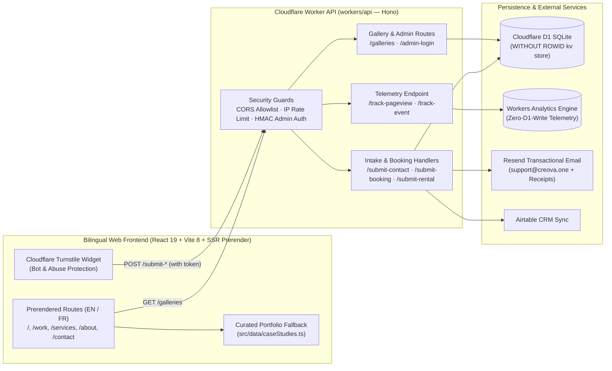

# CREOVA (`creova.one`)

**Ontario's BIPOC creative agency & venture studio flagship — commercial photography, cinema production, brand systems, and cultural platform engineering.**

[](https://github.com/creova-gif/creova/actions/workflows/ci.yml)
[](https://www.creova.one)
[](LICENSE)

Live production site: **[https://www.creova.one](https://www.creova.one)**

---

## System Overview

This repository houses both the bilingual (`EN` / `FR`) prerendered web frontend deployed to `creova.one` and the edge API backend (`workers/api/`) running on **Cloudflare Workers + D1 + Analytics Engine**.



### Implementation Status

| Subsystem | Location | Status |
| --- | --- | --- |
| **Bilingual (`EN`/`FR`) Frontend & Build-Time SSR Prerender** | `src/`, `src/entry-server.tsx`, `scripts/prerender.mjs` | **Implemented & Verified** |
| **Public Content & Metadata Validation** | `scripts/validate-public-content.mjs` | **Implemented & Verified** |
| **Cloudflare Worker + D1 Edge API (Hono)** | `workers/api/src/` | **Implemented & Verified** |
| **Turnstile Bot Verification, CORS & HMAC Admin Auth** | `workers/api/src/`, `src/supabase/functions/server/guards.ts` | **Implemented & Verified** |
| **Resend Transactional Email & Airtable Lead Sync** | `workers/api/src/` | **Implemented & Verified** |
| **Legacy Supabase Edge Function** | `src/supabase/functions/server/` | **Deprecated (Retained for Guard Parity Tests)** |

---

## Engineering Decisions

See [ADR 0001: Prerendered Bilingual React SPA + Cloudflare Worker & D1 Edge API](docs/adr/0001-cloudflare-worker-d1-edge-api-and-prerendered-spa.md) for the complete architectural decision record.

1. **Build-Time SSR Prerendering with Deterministic Offline Fallback:**
   - Rather than requiring a live server at request time, `npm run build` compiles an SSR entry (`src/entry-server.tsx`) and prerenders every public route into static HTML (`scripts/prerender.mjs`) with route-accurate `<title>`, canonical, and OpenGraph tags. If `VITE_API_BASE_URL` is unset or unreachable, pages render deterministically from the curated repository portfolio (`src/data/caseStudies.ts`).
2. **Cloudflare Worker + `WITHOUT ROWID` D1 Schema:**
   - Migrating from the legacy Supabase Edge Function to Cloudflare Workers + D1 (`workers/api/`) eliminated cold-start latency and database pausing. The D1 schema uses `WITHOUT ROWID` without secondary indexes so each form submission costs exactly 1 row write, while page-view events route to Workers Analytics Engine (0 D1 writes).
3. **Fail-Closed Security Boundaries:**
   - All public mutation endpoints require a valid Cloudflare Turnstile token bound to `creova.one` / `www.creova.one` and fail closed (`503`) if `TURNSTILE_SECRET_KEY` is missing.
   - Admin routes never compare passwords in the browser; `/admin-login` verifies `ADMIN_PASSWORD` server-side and issues an HMAC-signed token (`ADMIN_SESSION_SECRET`).
   - Client environment variables (`VITE_*`) contain zero secret keys or hardcoded JWTs (`.env.example`).

---

## Quickstart & Verification

### Prerequisites
- **Node.js 22+** and `npm`

### Install & Run

```bash
npm ci
npm --prefix workers/api ci

# Start local Vite development server (http://localhost:5173)
npm run dev
```

### Verification Gates (`.ai/project.yaml`)

All four verification gates must exit `0` before merging:

```bash
npm run lint        # ESLint flat config (--max-warnings=0)
npm run typecheck   # Root tsc --noEmit + workers/api tsc --noEmit
npm test            # Server security guard tests + workers/api Vitest suite (4 configs)
npm run build       # Public content validation + client build + SSR build + route prerender
```

---

## Configuration

Copy `.env.example` to `.env.local` for local frontend configuration. Never place secret keys in `VITE_*` variables.

| Variable | Scope | Purpose |
| --- | --- | --- |
| `VITE_API_BASE_URL` | Frontend (`VITE_`) | Cloudflare Worker API prefix (`https://<worker>.workers.dev/make-server-feacf0d8`) |
| `VITE_TURNSTILE_SITE_KEY` | Frontend (`VITE_`) | Cloudflare Turnstile public widget key |
| `VITE_SENTRY_DSN` | Frontend (`VITE_`) | Optional Sentry browser error reporting DSN |
| `VITE_SEEN_SITE_URL` / `VITE_VERSE_SITE_URL` | Frontend (`VITE_`) | Optional outbound venture links |
| `TURNSTILE_SECRET_KEY` | Worker Secret | Server-side Turnstile verification secret (`wrangler secret put`) |
| `ADMIN_PASSWORD` / `ADMIN_SESSION_SECRET` | Worker Secret | Admin login password & HMAC signing secret (`wrangler secret put`) |
| `EMAIL_SERVICE_API_KEY` / `AIRTABLE_API_KEY` | Worker Secret | Resend & Airtable API keys (`wrangler secret put`) |

Full Worker deployment, D1 migration, and rollback procedures: [`workers/api/README.md`](workers/api/README.md) and [`docs/GO_LIVE_RUNBOOK.md`](docs/GO_LIVE_RUNBOOK.md).

---

## Repository Structure

```text
.
├── src/                  # Bilingual (EN/FR) React 19 + Vite frontend, design tokens, and SSR entry
├── workers/api/          # Cloudflare Worker + D1 + Analytics Engine API (Hono + Vitest suite)
├── scripts/              # Build-time SSR prerender, PDF generator, and public content validator
├── public/               # Static brand, portfolio, and SEO assets
├── docs/                 # Runbooks, ADRs (docs/adr/), benchmarks, and archived audits (docs/archive/)
├── .ai/project.yaml      # Machine-readable verification contract
└── .github/workflows/    # CI verification and deployment pipelines
```

---

## Governance & License

- **Design System:** [`DESIGN.md`](DESIGN.md)
- **Security Policy:** [`SECURITY.md`](SECURITY.md)
- **Contributing:** [`CONTRIBUTING.md`](CONTRIBUTING.md) · [`CODE_OF_CONDUCT.md`](CODE_OF_CONDUCT.md)
- **License:** Proprietary — All Rights Reserved ([`LICENSE`](LICENSE)). Built by [Justin Mafie](https://github.com/creova-gif).
